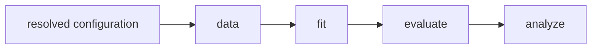

# Training-free behavior cloning

`dev-final-consolidated` retains the manuscript's action-ridge and Fisher
retrieval methods, affine continuation, shared-support RFF correction, and
NHC/NNC/NLR ablations. The headline is **radius-normalized sparsemax Fisher
with binary gripper actions**.

Source provenance: [`madang6/dpc-nldl@964259c`](https://github.com/madang6/dpc-nldl/tree/964259cc24e13ebc177fd45e38d3d860240b5a19),
retaining the `dev-final-consolidated` branch history.

The recorded eight-task result is **72.25% (1,734/2,400)**. That campaign ran
source `0c8975d`; `dev-fast-consolidated@48bc022` consolidated it with numerical
equivalence checks. This branch does not claim a new rollout result.
[Recipe, results, and provenance](docs/fisher_sparsemax.md).

## Run

Edit the shared dataset, bank, output, and worker paths in
[`configs/robosuite_common.json`](configs/robosuite_common.json), then use one
entrypoint:

| Configuration | Method |
|---|---|
| [`robosuite_fisher_sparsemax_local.json`](configs/robosuite_fisher_sparsemax_local.json) | Fisher retrieval and adaptive sparsemax support |
| [`robosuite_action_ridge_local.json`](configs/robosuite_action_ridge_local.json) | Closed-form action-supervised ridge retrieval |
| [`robosuite_nhc_local.json`](configs/robosuite_nhc_local.json) | Uniform continuation weights, retaining the RFF correction |
| [`robosuite_nnc_local.json`](configs/robosuite_nnc_local.json) | Affine continuation without the nonlinear correction |
| [`robosuite_nlr_local.json`](configs/robosuite_nlr_local.json) | Raw history-distance retrieval, retaining affine continuation and correction |

```bash
scripts/build_robosuite_runtime.sh
python3 scripts/run_experiment.py configs/robosuite_fisher_sparsemax_local.json --detach
```

The shared template is not an entrypoint. Its objects merge recursively into
each configuration; lists and scalars replace inherited values. Every run
records the fully resolved configuration, so resuming does not depend on later
changes to the template.

The pipeline is `data → fit → evaluate → analyze`. It supports local or SSH GPU
workers, immutable encoded-bank caches, resumable artifacts, and per-task
configuration overrides. Build the configured Docker image on each worker;
`runtime.native_python` can instead select an existing runtime. Worker strings
such as `local=0` or `endor=0@3` specify a GPU and optional allocation weight.

```bash
python3 scripts/run_experiment.py --run experiments/<run> --stage fit --detach
python3 scripts/run_experiment.py --run experiments/<run> --stage evaluate --detach
python3 scripts/run_experiment.py --run experiments/<run> --stage analyze
```

Each task writes policies, episode outcomes, optional compact traces, summary
tables, plots, and a report below `tasks/<benchmark>/<task>/`. The separate
π₀.₅ [LoRA configuration](configs/robosuite_pi05_lora.json) retains the fine-tuned
comparator; it does not add BPC model choices.

## Retained behavior

The headline uses 1,000 demonstrations per task, 16,384 retrieval RFFs, up to
all eligible fitting histories, rank-70 Fisher projection, and an independent 16,384-RFF
correction. It evaluates seeds 100000–100299 on eight tasks. Square uses five
history/warmup steps; the other tasks use ten. Warmup plus control spans 600
steps. The seven-dimensional action retains the binary gripper command.

Fisher fits the radius-normalized sparsemax future-action teacher and omits
zero-mass classes from covariance estimation. Retrieval compares individual
history embeddings; density-normalized sparsemax keeps every positive support
weight. `g.supports: 64` controls teacher/reference neighborhoods, not the final
adaptive support count. Affine reconstruction uses the untruncated exact solve.

The tested recipe's additional active mechanisms remain enabled:

- Temporal rates `[0.5, 0.75, 1, 1.5, 2]`, aligned histories/futures, and scaling
  of the first six action coordinates. The gripper is unchanged, and residual
  targets use the same retimed first action.
- Legacy opt-in empty-grasp recovery (disabled in the default Fisher config), calibrated from demonstrations: 12 closed-command
  settling steps, up to 40 steps retrieving opening continuations, 5% demo tabu,
  and at most three attempts per episode.
- Teacher-coverage calibration, mixed retrieval with refinement/fallback,
  batched target generation, host-paged RFFs, and bounded concurrent readouts.

The manuscript does not currently describe temporal retiming. Recovery is disabled
in the default Fisher recipe. See [the recovery-free update](docs/recovery_free_default.md)
for the full-data fit, matched evidence, and remaining execution mechanisms.

NHC and NNC retain the headline's retrieval and temporal settings. NLR uses
native timing because raw history-distance retrieval has no learned temporal
index. Action ridge and NLR use FP64 retrieval; mixed retrieval is specific to
Fisher adaptive coverage. These ablation configurations are executable
definitions, not newly validated reproductions of the manuscript's table.

Inactive research choices are removed from the implementation and configuration
surface: Adam neighborhood fitting, sparsemax-QP, prototype LDA, alternative
teachers, SPC refinement, expert fusion, neural residuals, TSVD reconstruction,
previous-plan penalties, and separate temporal residual retrieval.

The experiment surface is RoboSuite with R3M features for BPC and the separate
fine-tuned π₀.₅ comparator. LIBERO/RoboCasa adapters, SDP/π₀.₅ BPC encoders,
the frozen calibrated π₀.₅ experiment, and the unused `CertifiedDensitySearch`
path are removed, together with their exclusive configuration, documentation,
and tests. Retired configuration choices fail validation before workers launch.
Shared dependencies of the retained methods remain available.

The branch includes the standard experiment launcher, the shared base-image,
RoboSuite and π₀.₅ runtime builders, and validation/LOC utilities. Standalone
performance probes, prototype implementations, historical study harnesses, and optional
mechanism-plot tooling remain in Git history at `2cb8291`.
Standard analysis produces success rates, Wilson intervals, paired McNemar
comparisons, endpoint CSVs, outcome plots, and reports. All BPC configurations
inherit the shared 95% confidence level, including the ablations.

## Code boundaries

| Module | Responsibility |
|---|---|
| `bpc.py` | BPC policy state, retrieval/continuation/correction composition, and recovery |
| `retrieval.py`, `lda_selector.py` | Retrieval strategies, learned metrics, adaptive supports, and search precision |
| `density_search.py` | Shared input validation and numerical bounds for mixed/fused density search |
| `fitting.py` | Shared local/sharded target batches, RFF basis/features, fitting, and diagnostics |
| `artifacts.py` | Cache identity, staged fits, serialization, and loading |
| `precision.py` | Shared full-FP32 scopes with each path's original restoration order |
| `readout_bookkeeping.py`, `readout_contracts.py` | Shared trace assembly and accelerator compatibility |
| `ragged_readout.py`, `target_readout.py`, `concurrent_readout.py` | Optional execution backends |

Retrievers share `fit(policy)` and `project(policy, queries)` and hold no policy
reference, so execution state remains independent. The configuration
factory exposes only the retained manuscript choices. Adding a retriever does
not require changing policy dispatch; accelerator eligibility is checked
separately. Inherited numerical methods retain acceleration, while overrides
use ordinary execution. Captured graphs also reject instance overrides and
invalidate when their tensor/scalar dependencies change. Captured execution
owns an explicit state snapshot; one field declaration defines both ownership
and invalidation, without copying rollout state or replacing instance methods.

Configuration inheritance and task overrides share a recursive merger that
isolates mutable values. Staged lookup preparation and loading share validation,
so incomplete artifacts are rebuilt. Disabling compact traces skips diagnostic
transfers and accumulation; scalar policy histories then remain bounded.

The public policy and run entrypoints remain available. Removed private
previous-plan arguments have no replacement; executed-action history and
recovery state remain active. Artifact keys and payload formats are preserved,
including the joint RFF solve required for numerical compatibility. Legacy
trace aliases remain for consumers of saved diagnostics.

## Validate

```bash
python scripts/run_tests.py --suite unit
python scripts/run_tests.py --suite integration
python scripts/run_tests.py --suite cuda
```

[Test groups and fixture conventions](tests/README.md) explain the distinct
checks and how to run all groups together.

A seeded CPU comparison against `48bc022` matched 193 common tensor/scalar
values exactly, including tensor bytes, across Fisher fitting/calibration, RFF
fitting, all five temporal rates, affine actions, saved-policy reload, and
triggered empty-grasp recovery. This used reduced dimensions; timing metadata
and the removed previous-plan diagnostic were excluded.

A further seeded CPU comparison against `fbb4641` matched 957 tensors and 341
metadata values exactly across Fisher (device/host teacher storage), action
ridge, NHC, NNC, and NLR. Reduced fixtures covered target shards, fitted
payloads, supports, online actions/traces, saved reloads, and cached refits.
Existing fresh-versus-reloaded residual rounding remains unchanged.
All 40 retained BPC task configurations and fit identities also match that
revision. Synthetic R3M bank generation matches exactly for both action replay
and recorded-state rerendering, including metadata.

CUDA tests require the matching toolkit and a visible GPU. Integration and
numerical parity checks do not substitute for another full rollout campaign.

All 213 unit, 72 integration, and 89 CUDA checks pass. Standard analysis outputs
match `fbb4641` byte-for-byte for 43 configured task combinations and a paired
comparison using identical resolved settings and synthetic episode outcomes.
CUDA checks cover graph reuse/invalidation, extension fallbacks, temporal
readout, RFF fitting, and host paging. CPU checks used PyTorch 2.3.0; CUDA
checks used PyTorch 2.7.1/CUDA 12.8 on an RTX 4090.

<!-- flow:start -->

<!-- flow:end -->

Physical source lines cover `src/dpc_nldl`, `scripts`, and `tests`, including
comments and blanks; configurations, documentation, and generated binaries are
excluded. Baselines are the earlier `dev-final-consolidated` (`97ebf4a`),
the recipe consolidation (`48bc022`), and the scope cleanup before this
structural pass (`2a00d4e`), plus the structural result before test cleanup
(`6c8e70e`), the test cleanup (`2cb8291`), and development-tool retirement
(`ab29f39`), followed by the shared-contract cleanup (`fbb4641`). The first
structural pass reduced the policy module (now `bpc.py`) from 2,316 to 1,354
lines. The latest pass removes the extra experiment paths and their exclusive
support code while retaining distinct precision paths, numerical fallbacks,
and saved-artifact compatibility.
The `48bc022` column preserves verified counts from the source repository;
that comparison commit is outside this branch's ancestry.
Refresh with
`python3 scripts/readme_diagrams.py`.

<!-- size-table:start -->
| Scope | `97ebf4a` | `48bc022` | `2a00d4e` | `6c8e70e` | `2cb8291` | `ab29f39` | `fbb4641` | Current worktree |
|---|---:|---:|---:|---:|---:|---:|---:|---:|
| Python implementation | 10053 | 10201 | 8554 | 8653 | 8653 | 8355 | 8383 | 7650 |
| Python/shell scripts | 5564 | 5677 | 5536 | 5478 | 5519 | 741 | 741 | 692 |
| CUDA/C++ and headers | 1203 | 1282 | 772 | 772 | 772 | 772 | 772 | 772 |
| Python tests | 10319 | 10516 | 9745 | 9955 | 9927 | 8738 | 8889 | 8679 |
| **Total** | **27139** | **27676** | **24607** | **24858** | **24871** | **18606** | **18785** | **17793** |
<!-- size-table:end -->
