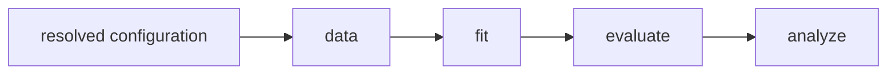

# Code map

| Module | Responsibility |
|---|---|
| `src/bpc/bpc.py` | Policy state and composition of retrieval, continuation, and correction |
| `src/bpc/retrieval.py`, `lda_selector.py`, `full_fisher.py` | Retrieval metrics, Fisher fitting, and adaptive support selection |
| `src/bpc/affine.py` | Constrained affine reconstruction |
| `src/bpc/fitting.py` | Residual targets, random Fourier features, and ridge fitting |
| `src/bpc/artifacts.py` | Fit identity, caching, serialization, and loading |
| `src/bpc/loader.py` | Saved-run loading and artifact schema compatibility |
| `src/bpc/robosuite.py`, `adroit.py`, `dexart.py` | Simulator adapters |
| `src/bpc/evaluate.py`, `analyze.py` | Rollouts and result analysis |
| `scripts/run_experiment.py` | Runtime selection and experiment orchestration |

<!-- flow:start -->

<!-- flow:end -->

Physical source lines include comments and blanks in `src/bpc`, `scripts`,
and `tests`. Configurations, documentation, and generated binaries are excluded.
Refresh this page with `python3 scripts/update_code_map.py`.

<!-- size-table:start -->
| Scope | Current worktree |
|---|---:|
| Python implementation | 8813 |
| Python/shell scripts | 841 |
| CUDA/C++ and headers | 772 |
| Python tests | 8976 |
| **Total** | **19402** |
<!-- size-table:end -->
